# Diseño de la Arquitectura de una Aplicación Empresarial con ArchiMate y DDD

## Tema 5 — Gestión del arrendamiento de yates de terceros

Este repositorio documenta el diseño de arquitectura empresarial, descomposición SOA y modelado DDD de una aplicación para una empresa que comercializa y opera arrendamientos de yates pertenecientes a terceros. El trabajo parte del entendimiento del negocio y avanza hasta dominios, agregados, bounded contexts, interoperabilidad y trazabilidad vertical.

El modelo se construye en **ArchiMate** y mantiene una separación explícita entre negocio, servicios, dominio e implementación. A partir de la Fase 3, el diseño se representa principalmente en la capa de aplicaciones, conservando trazabilidad hacia las motivaciones, capacidades y servicios de negocio.

> **Alcance consolidado de la iteración:** las únicas integraciones externas automáticas que se implementan como integración real son **A07 Pasarela de pagos** y **A10 Sistema contable/facturador**. La marina opera directamente en la plataforma mediante su portal; evaluador de riesgo, aseguradora, autoridades y peritos se manejan mediante registro/traducción controlada según el caso; A13 Meteorología queda fuera de alcance. Un dominio no equivale automáticamente a un bounded context, y un bounded context no equivale automáticamente a un microservicio.

---

<a id="indice"></a>
## Índice

- [Estructura del repositorio](#estructura-del-repositorio)
- [Convención de nombres de imágenes](#convencion-de-nombres-de-imagenes)
- [Fase 0 — Entrevista al experto](#fase-0)
- [Fase 1 — Entendimiento del negocio y mapa de capacidades](#fase-1)
  - [V1 — Motivación](#v1)
  - [V2 — Mapa de capacidades](#v2)
  - [V3 — Cadena de valor y proceso E2E](#v3)
- [Fase 2 — Descomposición de servicios e interoperabilidad](#fase-2)
  - [V4 — Descomposición de servicios](#v4)
  - [V4b — Servicios, roles, funciones y contratos](#v4b)
  - [V4c — Servicios fundamentales e infraestructura](#v4c)
  - [V4d — Trazabilidad servicio–capacidad–requisito–meta](#v4d)
  - [V4e — Trazabilidad de servicios a capacidades](#v4e)
  - [V9 — Interoperabilidad y anticorrupción](#v9)
  - [V9b — Vínculo vertical y contratos de integración](#v9b)
- [Fase 3 — DDD estratégico](#fase-3)
  - [V5 — Dominios y clasificación](#v5)
  - [V7 — Lenguaje ubicuo Core](#v7-core)
  - [V7 — Lenguaje ubicuo Supporting](#v7-supporting)
  - [V7 — Lenguaje ubicuo Generic](#v7-generic)
  - [V7 — Términos polisémicos](#v7-polisemicos)
- [Fase 4 — DDD táctico](#fase-4)
  - [V6.1 — Gestión del Arrendamiento](#v61)
  - [V6.2 — Decisión de Riesgo del Arrendamiento](#v62)
  - [V6.3 — Gestión de Propietarios y Yates](#v63)
  - [V6.4 — Gestión de Marinas y Operación Náutica](#v64)
  - [V6.5 — Gestión de Incidentes y Siniestros](#v65)
  - [V6.6 — Tarifación y Cotización](#v66)
  - [V6.7 — Admisibilidad y Cumplimiento](#v67)
  - [V6.8 — Seguimiento Operacional](#v68)
  - [V6.9 — Liquidación Económica](#v69)
  - [V6.10 — Reputación y Calidad](#v610)
  - [V6.11 — Pagos y Facturación](#v611)
  - [V6.12 — Analítica y Reportes](#v612)
- [Fase 5 — Mapa de contextos delimitados](#fase-5)
  - [V8 — Mapa de contextos](#v8)
  - [V8b — Flujos de eventos entre contextos](#v8b)
  - [V8c — Fronteras externas y tratamiento actual](#v8c)
- [Fase 6 — Bounded Context Canvas](#fase-6)
  - [V11 — Canvas de Gestión del Arrendamiento](#v11)
- [Vista transversal — V10 Trazabilidad vertical](#v10)
- [Tabla de aportes](#tabla-de-aportes)
- [Fuentes del proyecto](#fuentes-del-proyecto)

---

<a id="estructura-del-repositorio"></a>
## Estructura del repositorio

```text
/
├── README.md
├── modelo/
│   └── Modelo_Yates_UNIFICADO_CON_V10.archimate
├── vistas/
│   ├── V1_Motivacion.png
│   ├── V2_Mapa_Capacidades.png
│   ├── V3_Cadena_Valor_E2E.png
│   ├── V4_Descomposicion_Servicios.png
│   ├── V4b_Servicios_Roles_Funciones_Contratos.png
│   ├── V4c_Fundamentales_Infraestructura.png
│   ├── V4d_Trazabilidad_Servicio_Capacidad_Requisito_Meta.png
│   ├── V4e_Trazabilidad_Servicios_Capacidades.png
│   ├── V5_Dominios_Clasificacion.png
│   ├── V6_01_Gestion_Arrendamiento.png
│   ├── V6_02_Decision_Riesgo.png
│   ├── V6_03_Propietarios_Yates.png
│   ├── V6_04_Marinas_Operacion_Nautica.png
│   ├── V6_05_Incidentes_Siniestros.png
│   ├── V6_06_Tarifacion_Cotizacion.png
│   ├── V6_07_Admisibilidad_Cumplimiento.png
│   ├── V6_08_Seguimiento_Operacional.png
│   ├── V6_09_Liquidacion_Economica.png
│   ├── V6_10_Reputacion_Calidad.png
│   ├── V6_11_Pagos_Facturacion.png
│   ├── V6_12_Analitica_Reportes.png
│   ├── V7_Lenguaje_Core.png
│   ├── V7_Lenguaje_Supporting.png
│   ├── V7_Lenguaje_Generic.png
│   ├── V7_Terminos_Polisemicos.png
│   ├── V8_Mapa_Contextos.png
│   ├── V8b_Flujos_Eventos_Contextos.png
│   ├── V8c_Fronteras_Externas.png
│   ├── V9_Interoperabilidad_Anticorrupcion.png
│   ├── V9b_Contratos_Integracion.png
│   ├── V10_Trazabilidad_Vertical.png
│   └── V11_Bounded_Context_Canvas.png
└── entrevista/
    ├── 01_Guion_y_Prompt.docx
    ├── 02_Conversacion_Entrevista.docx
    ├── 03_Preguntas_Adicionales.docx
    └── 04_Analisis_Hallazgos.md
```

> El archivo fuente final es `modelo/Modelo_Yates_UNIFICADO_CON_V10.archimate` y contiene las **32 vistas** del modelo. Dentro de Archi, las vistas de las Fases 1 y 2 están organizadas en la carpeta `Fase 1 y 2`; las Fases 3, 4, 5 y 6 conservan sus carpetas correspondientes y V10 queda como vista transversal. Las imágenes de `/vistas` son exportaciones del mismo modelo y se muestran en este README mediante enlaces relativos; no se duplican manualmente.

[Volver al índice](#indice)

---

<a id="convencion-de-nombres-de-imagenes"></a>
## Convención de nombres de imágenes

Para evitar enlaces rotos, las imágenes deben llamarse exactamente como aparece en la siguiente tabla. Si ya fueron exportadas con otro nombre, se recomienda **renombrarlas** en vez de modificar decenas de enlaces del README.

| Vista | Nombre recomendado |
|---|---|
| V1 | `V1_Motivacion.png` |
| V2 | `V2_Mapa_Capacidades.png` |
| V3 | `V3_Cadena_Valor_E2E.png` |
| V4 | `V4_Descomposicion_Servicios.png` |
| V4b | `V4b_Servicios_Roles_Funciones_Contratos.png` |
| V4c | `V4c_Fundamentales_Infraestructura.png` |
| V4d | `V4d_Trazabilidad_Servicio_Capacidad_Requisito_Meta.png` |
| V4e | `V4e_Trazabilidad_Servicios_Capacidades.png` |
| V5 | `V5_Dominios_Clasificacion.png` |
| V6.1 | `V6_01_Gestion_Arrendamiento.png` |
| V6.2 | `V6_02_Decision_Riesgo.png` |
| V6.3 | `V6_03_Propietarios_Yates.png` |
| V6.4 | `V6_04_Marinas_Operacion_Nautica.png` |
| V6.5 | `V6_05_Incidentes_Siniestros.png` |
| V6.6 | `V6_06_Tarifacion_Cotizacion.png` |
| V6.7 | `V6_07_Admisibilidad_Cumplimiento.png` |
| V6.8 | `V6_08_Seguimiento_Operacional.png` |
| V6.9 | `V6_09_Liquidacion_Economica.png` |
| V6.10 | `V6_10_Reputacion_Calidad.png` |
| V6.11 | `V6_11_Pagos_Facturacion.png` |
| V6.12 | `V6_12_Analitica_Reportes.png` |
| V7 Core | `V7_Lenguaje_Core.png` |
| V7 Supporting | `V7_Lenguaje_Supporting.png` |
| V7 Generic | `V7_Lenguaje_Generic.png` |
| V7 Polisémicos | `V7_Terminos_Polisemicos.png` |
| V8 | `V8_Mapa_Contextos.png` |
| V8b | `V8b_Flujos_Eventos_Contextos.png` |
| V8c | `V8c_Fronteras_Externas.png` |
| V9 | `V9_Interoperabilidad_Anticorrupcion.png` |
| V9b | `V9b_Contratos_Integracion.png` |
| V10 | `V10_Trazabilidad_Vertical.png` |
| V11 | `V11_Bounded_Context_Canvas.png` |

[Volver al índice](#indice)

---

<a id="fase-0"></a>
# Fase 0 — Entrevista al experto del negocio

La arquitectura se apoya en una entrevista estructurada al experto del negocio. El objetivo fue comprender el modelo de operación, actores, reglas, excepciones, indicadores, normatividad e interoperabilidades antes de diseñar capacidades, servicios o dominios.

Documentos recomendados dentro de `/entrevista`:

- [Guion e instrucción de rol](entrevista/01_Guion_y_Prompt.docx)
- [Conversación completa exportada](entrevista/02_Conversacion_Entrevista.docx)
- [Preguntas adicionales y aclaraciones](entrevista/03_Preguntas_Adicionales.docx)
- [Análisis de hallazgos](entrevista/04_Analisis_Hallazgos.md)

### Hallazgos que condicionan todo el diseño

- La empresa administra yates de terceros; el valor principal está en **gestión del riesgo**, red de **propietarios y marinas**, seguimiento y coordinación del arriendo.
- La operación completa no termina en la reserva: incluye preparación, entrega, navegación, devolución, inspección, liquidación, depósito y reputación.
- El evaluador externo **recomienda**, pero la decisión final de riesgo permanece dentro de la empresa.
- Riesgo y Cumplimiento son controles independientes.
- La marina participa en la operación física y usa directamente la plataforma en el alcance final.
- El propietario mantiene la póliza anual y el mantenimiento del yate; la póliza específica por arriendo es diferente.
- Las únicas integraciones externas automáticas del alcance final son la pasarela de pagos y el sistema contable/facturador.

[Volver al índice](#indice)

---

<a id="fase-1"></a>
# Fase 1 — Entendimiento del negocio y mapa de capacidades

La Fase 1 ubica la solución dentro de la arquitectura empresarial. Todavía no define componentes de software ni microservicios: explica **por qué existe la aplicación**, **qué capacidades del negocio impacta** y **en qué proceso E2E genera valor**.

<a id="v1"></a>
## V1 — Motivación

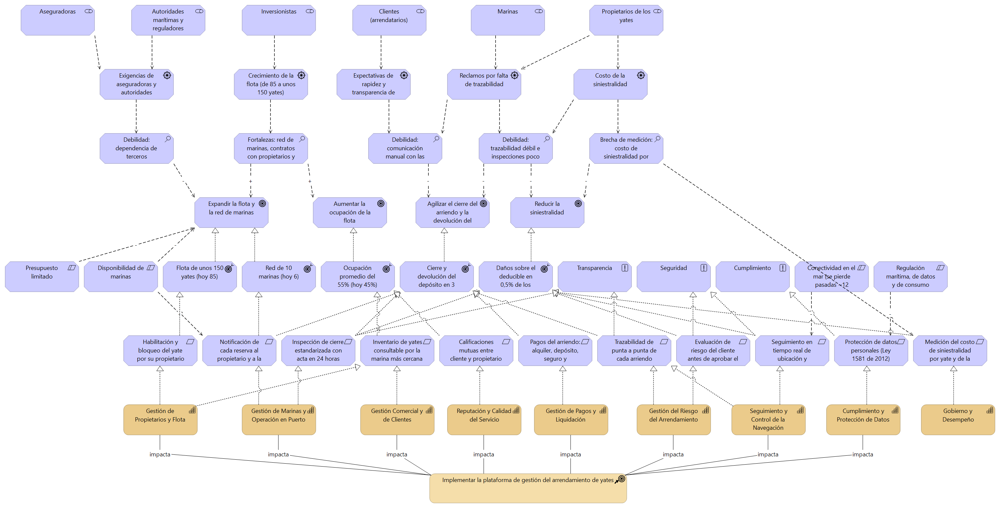

### Análisis

La vista reúne los elementos que justifican la solución: interesados, impulsores, evaluaciones del estado actual, metas, resultados esperados, principios, requerimientos y restricciones. Entre los impulsores se encuentran el crecimiento de la flota, el costo de la siniestralidad, la necesidad de trazabilidad y las expectativas de rapidez y transparencia de los clientes. Las evaluaciones muestran debilidades como la dependencia de terceros, comunicación manual con marinas y trazabilidad débil, junto con fortalezas como la red de marinas, contratos con propietarios y reputación.

Las metas se formulan como resultados de negocio y no como funcionalidades: ampliar la flota y la red de marinas, aumentar ocupación, reducir siniestralidad y agilizar el cierre del arriendo y la devolución del depósito. Los requerimientos sí expresan necesidades que la solución debe soportar: habilitación/bloqueo, seguimiento, inspección estandarizada, evaluación de riesgo, pagos, trazabilidad y protección de datos.

### Justificación de modelado

Se usa la capa de **Motivación** porque la intención de V1 es mantener trazabilidad entre la necesidad empresarial y lo que posteriormente se construye. Separar `Goal`, `Outcome`, `Requirement`, `Constraint` y `Principle` evita confundir una meta como “reducir siniestralidad” con una función como “gestionar depósitos”. La vista también conecta motivación con capacidades para que las decisiones posteriores no aparezcan como funcionalidades aisladas.

[Volver al índice](#indice)

---

<a id="v2"></a>
## V2 — Mapa de capacidades

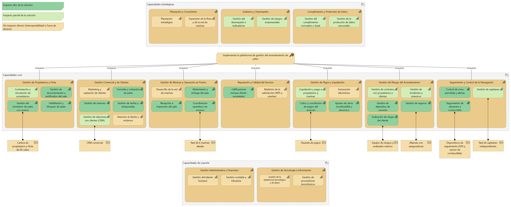

### Análisis

V2 representa **qué es capaz de hacer el negocio**, no pantallas ni casos de uso. Las capacidades se organizan en tres grandes grupos: estratégicas, core y de soporte. Dentro del núcleo se encuentran Gestión de Propietarios y Flota, Gestión Comercial y de Clientes, Gestión de Marinas y Operación en Puerto, Reputación y Calidad, Gestión de Pagos y Liquidación, Gestión del Riesgo del Arrendamiento y Seguimiento y Control de la Navegación.

También aparecen capacidades que no necesariamente se implementan en la aplicación pero sí existen en la organización, como talento humano, gestión contable o marketing. La vista distingue impacto alto, impacto parcial y ausencia de impacto directo para mostrar dónde la solución transforma realmente el negocio.

### Justificación de modelado

El elemento `Capability` es apropiado porque describe una habilidad estable de la organización, independiente del flujo específico que la ejecuta. La inclusión de `Resource` muestra activos que habilitan esas capacidades —flota, red de marinas, equipo de riesgos, CRM, dispositivos de seguimiento, pasarela— y `Course of Action` representa la decisión de implementar la plataforma. Esta separación permite que V2 sea reutilizable aunque cambien procesos o tecnologías.

[Volver al índice](#indice)

---

<a id="v3"></a>
## V3 — Cadena de valor y proceso E2E

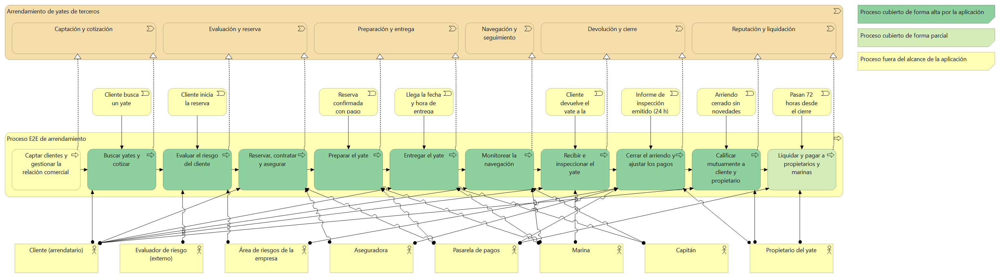

### Análisis

V3 muestra el flujo de valor completo del arrendamiento de yates de terceros y lo aterriza en un proceso E2E. El recorrido incluye captación/cotización, evaluación/reserva, preparación/entrega, navegación/seguimiento, devolución/cierre y reputación/liquidación. Se representan eventos de negocio que disparan transiciones relevantes: búsqueda del cliente, inicio de reserva, confirmación con pago inicial, fecha de entrega, devolución, inspección, cierre y liquidación posterior.

La vista conserva procesos que están fuera o parcialmente dentro del alcance de implementación, porque el E2E describe el negocio real y no solo lo que el software desarrollará en esta iteración. También deja visibles retrocesos y excepciones: bloqueos del propietario, suspensión de entrega por marina, cancelaciones y reubicaciones.

### Justificación de modelado

Se combinan `Value Stream`, `Business Process`, `Business Event` y `Business Actor` porque el objetivo es mostrar **cómo se crea valor de extremo a extremo** y quién participa. Esta vista sirve como punto de partida de la Fase 2: la descomposición SOA no inventa servicios desde cero, sino que parte de etapas y responsabilidades observadas en este proceso.

[Volver al índice](#indice)

---

<a id="fase-2"></a>
# Fase 2 — Descomposición de servicios e interoperabilidad

La Fase 2 transforma el E2E en una arquitectura de servicios de negocio. Se aplican múltiples niveles de descomposición, inclusión/exclusión de alcance, Contract First y modelado explícito de interoperabilidad.

<a id="v4"></a>
## V4 — Descomposición de servicios

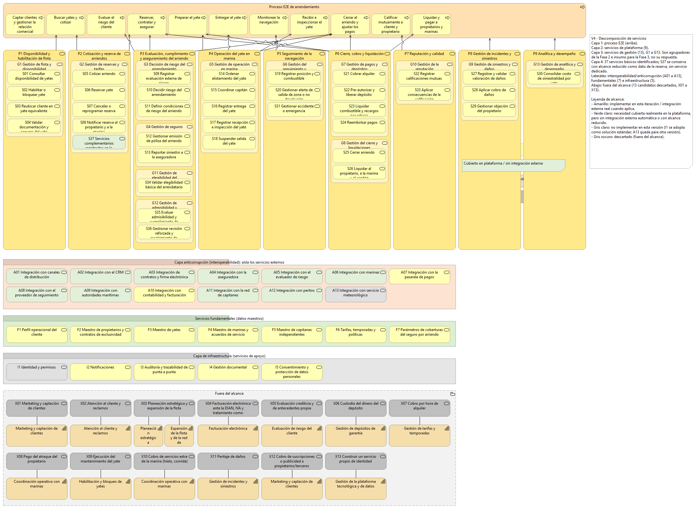

### Análisis

V4 descompone el proceso E2E en cuatro niveles: proceso, servicios de plataforma, servicios de gestión y servicios básicos. El modelo contiene servicios de gestión `G1–G13`, servicios básicos `S`, servicios fundamentales `F`, infraestructura `I`, interoperabilidad `A01–A13` y candidatos descartados `X`.

La vista no obliga a implementar todo lo identificado. Los colores expresan decisiones de alcance: implementar, cubrir dentro de la plataforma sin integración automática, adoptar una solución estándar, dejar para otra versión o descartar. Esa distinción es esencial porque identificar una necesidad no significa que deba construirse como servicio propio.

### Justificación de modelado

Los servicios se representan con `Business Service` porque en esta fase se diseña el servicio desde la perspectiva del negocio. La jerarquía permite demostrar que los servicios básicos nacen de una descomposición progresiva del E2E y que tienen un tamaño razonable para ser implementados posteriormente. V4 actúa además como puente hacia los dominios de Fase 3, pero no define todavía DDD.

[Volver al índice](#indice)

---

<a id="v4b"></a>
## V4b — Servicios, roles, funciones y contratos

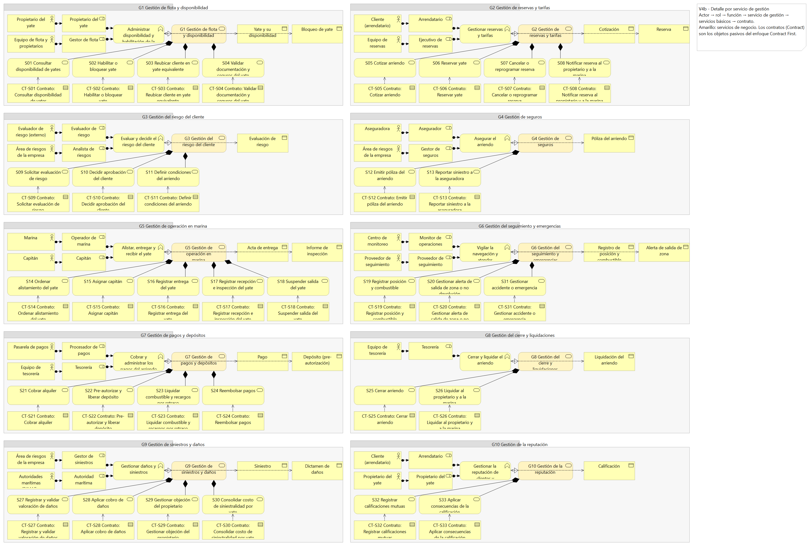

### Análisis

V4b detalla cada servicio de gestión siguiendo la cadena **actor → rol → función → servicio de gestión → servicios básicos → contrato**. El objetivo es mostrar quién presta el servicio, qué comportamiento lo realiza y qué contrato define su interacción.

### Justificación de modelado

Esta vista hace visible el principio **Contract First**. Los contratos se modelan como objetos pasivos y se definen antes de la implementación concreta. La separación entre rol, función y servicio evita confundir “quién lo hace”, “qué comportamiento realiza” y “qué valor expone el servicio”.

[Volver al índice](#indice)

---

<a id="v4c"></a>
## V4c — Servicios fundamentales e infraestructura

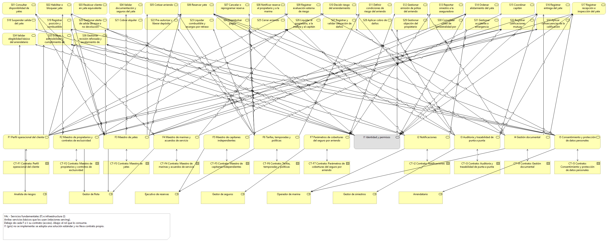

### Análisis

V4c separa los servicios fundamentales y de infraestructura de los servicios de negocio principales. Muestra qué servicios básicos consumen cada capacidad transversal, el contrato asociado y el rol que lo utiliza. Esta separación permite identificar necesidades reutilizables como identidad, notificaciones, trazabilidad, datos personales, maestros y políticas.

### Justificación de modelado

Los servicios transversales no deben duplicarse dentro de cada servicio de negocio. V4c los hace explícitos para reducir acoplamiento y promover reutilización. Cuando una necesidad se cubre adoptando una solución estándar —por ejemplo, una solución de identidad— se documenta como infraestructura adoptada y no como desarrollo propio.

[Volver al índice](#indice)

---

<a id="v4d"></a>
## V4d — Trazabilidad servicio–capacidad–requisito–meta

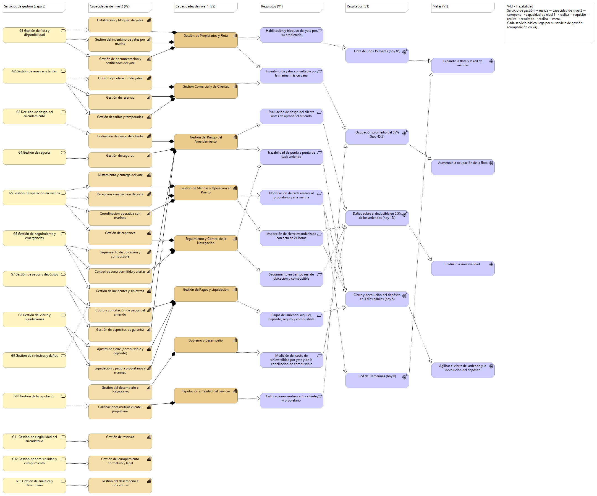

### Análisis

V4d demuestra una cadena vertical de trazabilidad desde un servicio de gestión hasta la motivación que lo justifica. La estructura conceptual es: **servicio de gestión → capacidad de nivel 2 → capacidad de nivel 1 → requisito → resultado → meta**.

### Justificación de modelado

Esta vista evita que los servicios aparezcan como decisiones técnicas sin origen empresarial. Las relaciones de realización e influencia permiten demostrar que un servicio existe porque habilita una capacidad y satisface un requisito que, a su vez, contribuye a un resultado y una meta. V4d anticipa el objetivo de V10, pero se concentra en los servicios de Fase 2.

[Volver al índice](#indice)

---

<a id="v4e"></a>
## V4e — Trazabilidad de servicios a capacidades

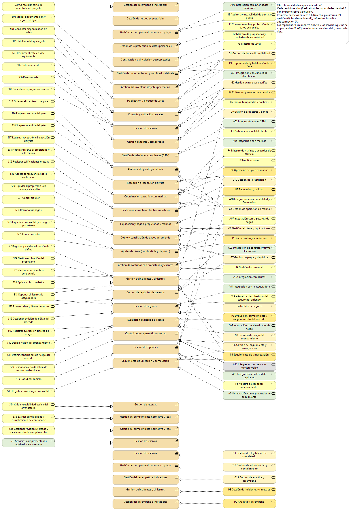

### Análisis

V4e amplía la trazabilidad de V4d y muestra cómo los servicios básicos, de plataforma, de gestión, fundamentales, de infraestructura y de anticorrupción realizan capacidades de nivel 2 impactadas por la solución.

### Justificación de modelado

V4d explica una cadena vertical; V4e verifica cobertura horizontal. Esta vista permite detectar capacidades impactadas sin servicios que las soporten o servicios sin una capacidad clara que los justifique. Las capacidades fuera de alcance o sin impacto directo no se fuerzan dentro de la vista.

[Volver al índice](#indice)

---

<a id="v9"></a>
## V9 — Interoperabilidad y anticorrupción

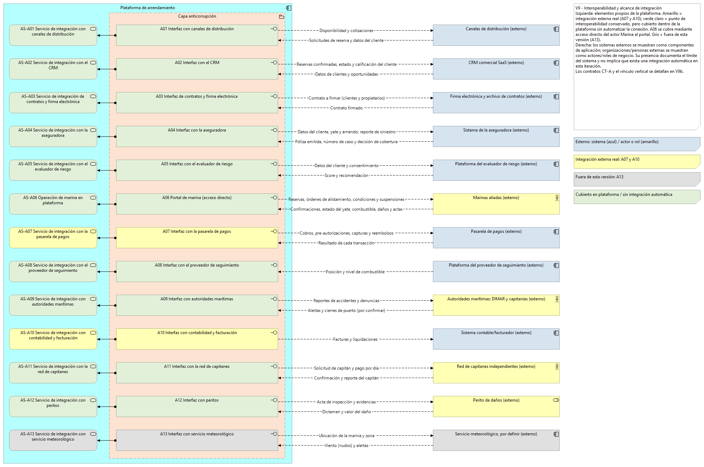

### Análisis

V9 delimita la plataforma frente a actores, sistemas y proveedores externos. El alcance final diferencia cuatro situaciones:

- **Integración externa real:** A07 Pasarela de pagos y A10 Sistema contable/facturador.
- **Acceso directo de actor externo:** A06 Marina usa directamente el portal de la plataforma.
- **Información externa registrada/traducida sin API automática:** evaluador de riesgo, aseguradora, autoridades y peritos, según el caso.
- **Fuera de alcance actual:** A13 Meteorología.

CRM, firma/gestión contractual y otros puntos de interoperabilidad permanecen como límites conocidos, pero no se convierten automáticamente en conectores reales en esta versión.

### Justificación de modelado

Se usan `Application Interface`, `Application Service` y `Application Component` para distinguir el punto de contacto propio, el servicio de integración y el sistema externo. Las organizaciones/personas externas —marina, autoridad, capitán, perito— se modelan como actores o roles de negocio cuando no existe un sistema concreto que deba representarse. La vista protege el modelo interno frente a dependencias externas y evita inventar APIs que no forman parte del alcance.

[Volver al índice](#indice)

---

<a id="v9b"></a>
## V9b — Vínculo vertical y contratos de integración

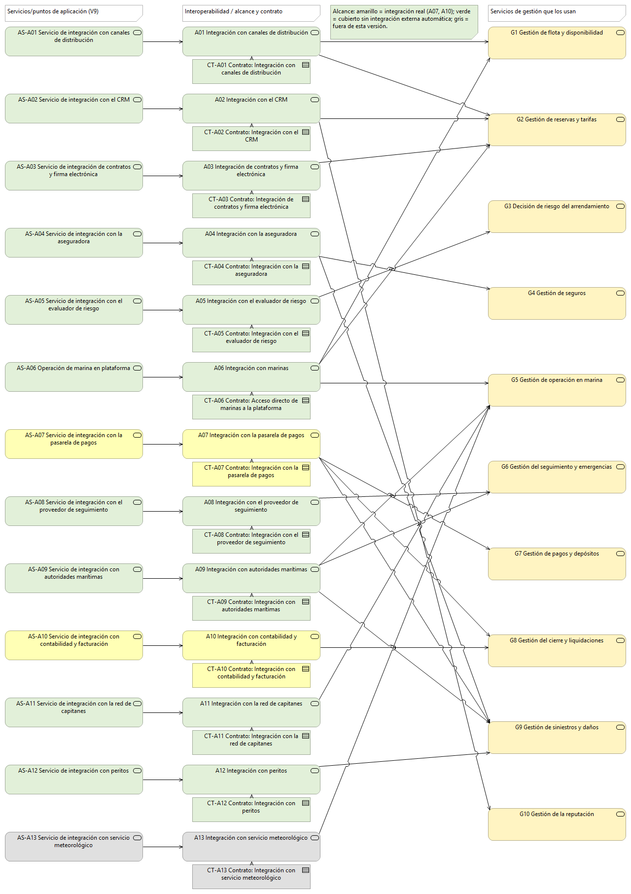

### Análisis

V9b complementa V9 mostrando, para cada punto A01–A13, el servicio de aplicación, el servicio de negocio relacionado y su contrato `CT-A`. También vincula esas interfaces con los servicios de gestión que las utilizan.

### Justificación de modelado

La vista demuestra que interoperabilidad no es solo una flecha hacia un sistema externo: debe existir un contrato que especifique información, dirección y responsabilidad. La separación entre contrato, servicio de aplicación y servicio de negocio mantiene trazabilidad entre el diseño SOA y la posterior arquitectura de aplicaciones.

[Volver al índice](#indice)

---

<a id="fase-3"></a>
# Fase 3 — DDD estratégico

La Fase 3 transforma el entendimiento del negocio y los servicios en un modelo de dominio. Se identifican fronteras de conocimiento, se clasifican dominios y se define un lenguaje ubicuo consistente.

<a id="v5"></a>
## V5 — Dominios y clasificación

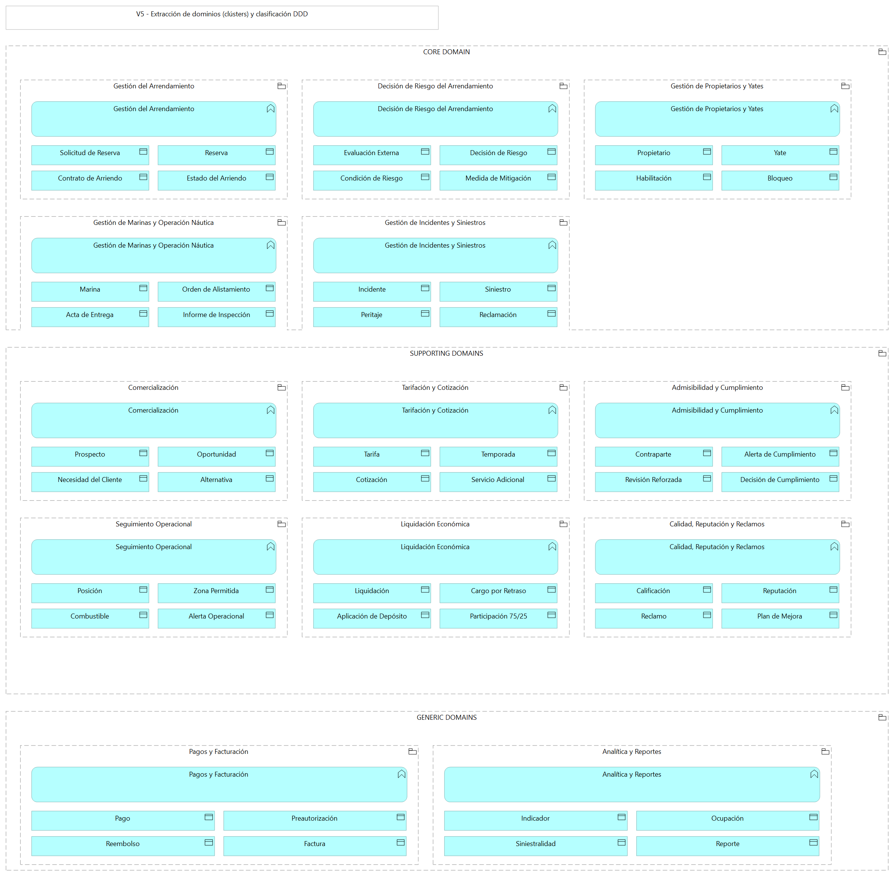

### Análisis

Se identificaron **12 dominios**, clasificados en:

**Core:** Gestión del Arrendamiento; Decisión de Riesgo del Arrendamiento; Gestión de Propietarios y Yates; Gestión de Marinas y Operación Náutica; Gestión de Incidentes y Siniestros.

**Supporting:** Tarifación y Cotización; Admisibilidad y Cumplimiento; Seguimiento Operacional; Liquidación Económica; Reputación y Calidad.

**Generic:** Pagos y Facturación; Analítica y Reportes.

La clasificación refleja qué conocimiento diferencia el negocio. La decisión interna de riesgo, la coordinación de la red de yates/marinas y la operación del arrendamiento son centrales. Pagos y analítica son necesarios, pero no constituyen por sí mismos la ventaja competitiva del negocio.

### Justificación de modelado

Los dominios se representan como `Grouping` en la capa de aplicaciones para expresar fronteras conceptuales sin asumir todavía que cada dominio sea un componente, bounded context o microservicio. La clasificación Core/Supporting/Generic permite priorizar dónde debe protegerse con mayor cuidado el modelo de negocio.

[Volver al índice](#indice)

---

<a id="v7-core"></a>
## V7 — Lenguaje ubicuo — Core

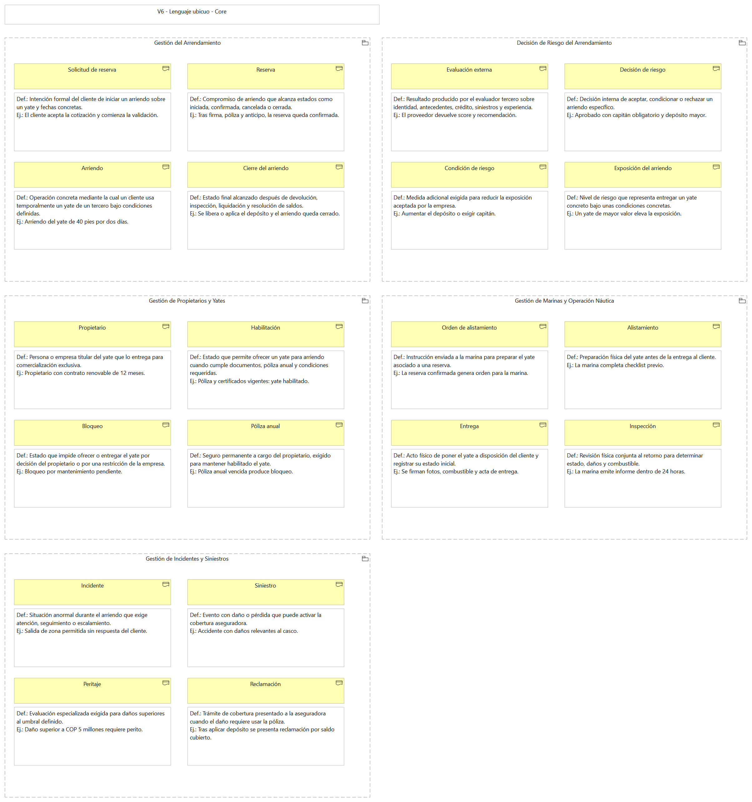

### Análisis

La vista agrupa términos propios de los dominios Core: Solicitud de reserva, Reserva, Arriendo, Contrato de arriendo, Elegibilidad, Decisión de riesgo, Condición de riesgo, Propietario, Yate, Habilitación, Bloqueo, Póliza anual, Marina, Alistamiento, Entrega, Inspección, Capitán, Incidente, Siniestro, Peritaje y Reclamación al seguro.

### Justificación de modelado

Los términos se modelan como `Business Representation`, siguiendo la recomendación del trabajo para V7. El objetivo no es crear clases sino asegurar que negocio y software utilicen los mismos conceptos. Separar el lenguaje por dominio evita que palabras aparentemente iguales oculten significados distintos.

[Volver al índice](#indice)

---

<a id="v7-supporting"></a>
## V7 — Lenguaje ubicuo — Supporting

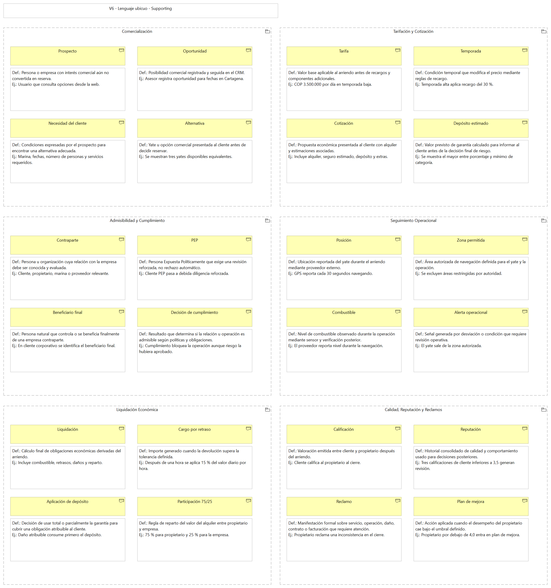

### Análisis

Esta vista reúne términos de los dominios de soporte: Tarifa, Temporada, Cotización, Depósito estimado, Contraparte, PEP, Beneficiario final, Decisión de cumplimiento, Posición, Zona permitida, Alerta operacional, Liquidación, Cargo por retraso, Depósito aplicado, Participación del propietario, Calificación, Reputación, Consecuencia y Plan de mejora.

### Justificación de modelado

Separar el lenguaje Supporting evita mezclar términos operativos/comerciales con conceptos que gobiernan los dominios Core. Estos términos apoyan al núcleo, pero tienen reglas y ciclos propios que deben conservar su significado.

[Volver al índice](#indice)

---

<a id="v7-generic"></a>
## V7 — Lenguaje ubicuo — Generic

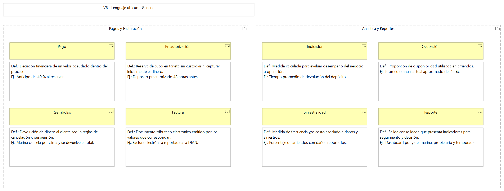

### Análisis

Los dominios genéricos concentran lenguaje financiero y analítico: Pago, Preautorización, Reembolso, Factura, Indicador, Ocupación, Siniestralidad y Reporte.

### Justificación de modelado

Estos conceptos son importantes para la solución, pero corresponden a problemas ampliamente conocidos y reutilizables. Mantenerlos separados ayuda a que el lenguaje financiero no invada el lenguaje del arrendamiento y a que la analítica no se convierta en fuente de verdad transaccional.

[Volver al índice](#indice)

---

<a id="v7-polisemicos"></a>
## V7 — Términos polisémicos por contexto

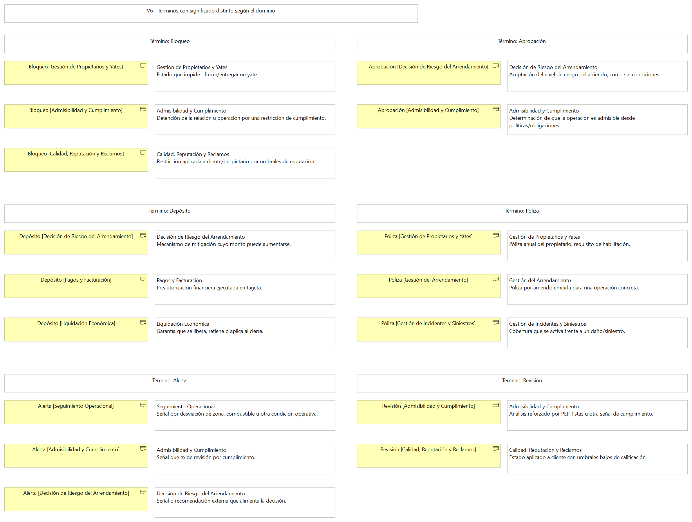

### Análisis

La vista hace explícitas palabras que cambian de significado según el contexto. Entre ellas:

- **Bloqueo:** yate no ofertable; operación bloqueada por Cumplimiento; restricción por Reputación.
- **Aprobación:** decisión de Riesgo vs. admisibilidad de Cumplimiento.
- **Depósito:** mitigación de Riesgo; preautorización en Pagos; garantía aplicada/liberada en Liquidación.
- **Póliza:** póliza anual del propietario; póliza por arriendo; cobertura activada en Siniestros.
- **Alerta:** operacional, de cumplimiento o de riesgo.
- **Revisión:** revisión reforzada de Cumplimiento o estado asociado a Reputación.

También diferencia **Solicitud de reserva**, **Reserva** y **Arriendo**.

### Justificación de modelado

La polisemia es una de las razones principales para establecer bounded contexts. Forzar una definición global produciría un modelo ambiguo. V7 documenta dónde cambia el significado y prepara las fronteras de Fase 5.

[Volver al índice](#indice)

---

<a id="fase-4"></a>
# Fase 4 — DDD táctico

La Fase 4 define agregados, raíces, entidades, objetos de valor, comandos, procesos de aplicación, eventos e invariantes. La convención usada es:

- límite del agregado → `Grouping`;
- Aggregate Root / Entity / Value Object / Command → `Data Object` con rol DDD documentado;
- manejo de comandos → `Application Process`;
- Domain Event → `Application Event`.

Las referencias a otros dominios se mantienen mediante identificadores, snapshots o eventos; no se modifican directamente agregados externos.

<a id="v61"></a>
## V6.1 — Gestión del Arrendamiento

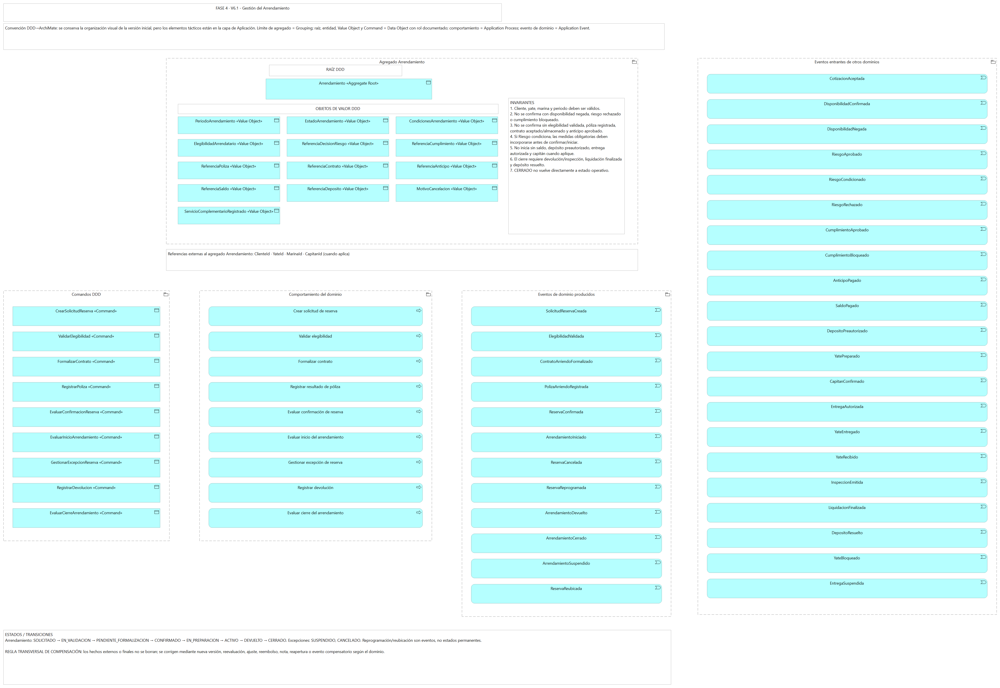

### Análisis

El agregado raíz `Arrendamiento` gobierna el ciclo completo: solicitud, validación, formalización, confirmación, preparación, inicio, devolución y cierre. Mantiene objetos de valor para periodo, estado, condiciones y referencias a Riesgo, Cumplimiento, Póliza, Contrato, Anticipo, Saldo y Depósito.

### Justificación

Arrendamiento funciona como **orquestador de estado**, no como dueño de todas las reglas. Consume resultados de otros dominios y decide si su propio ciclo puede avanzar. No confirma con disponibilidad negada, riesgo rechazado o cumplimiento bloqueado; tampoco inicia sin saldo, depósito, autorización de entrega y capitán cuando aplique. Las excepciones se modelan como suspensión, cancelación, reprogramación o reubicación sin borrar historial.

[Volver al índice](#indice)

---

<a id="v62"></a>
## V6.2 — Decisión de Riesgo del Arrendamiento

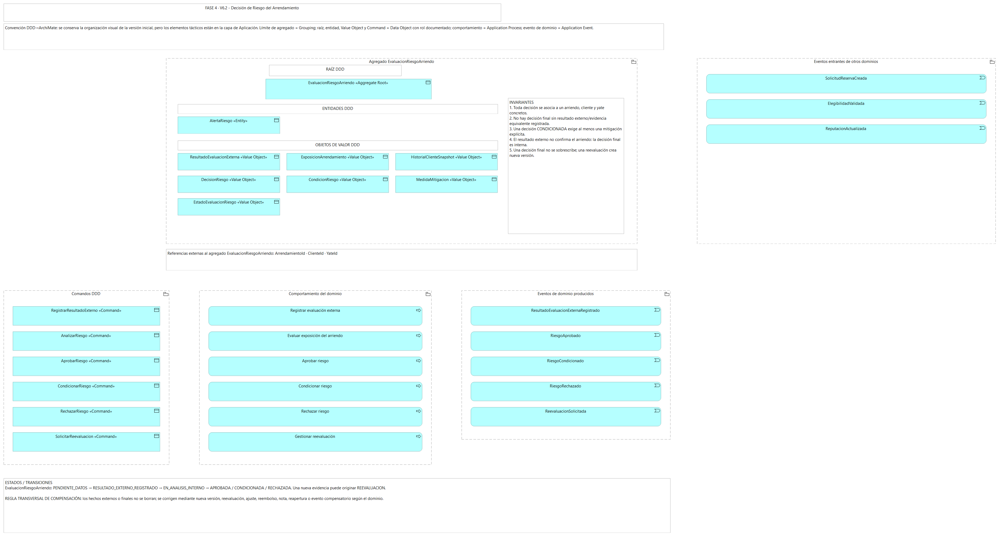

### Análisis

`EvaluacionRiesgoArriendo` es la raíz. Registra el resultado del evaluador externo, la exposición concreta del arriendo, alertas, historial relevante, decisión final y medidas de mitigación.

### Justificación

El evaluador externo no sustituye la decisión interna. El dominio puede aprobar, condicionar o rechazar. Una decisión condicionada debe incluir mitigaciones explícitas y una decisión final no se sobrescribe: una nueva evidencia genera reevaluación/versionado. Esto preserva trazabilidad y protege una regla crítica del negocio.

[Volver al índice](#indice)

---

<a id="v63"></a>
## V6.3 — Gestión de Propietarios y Yates

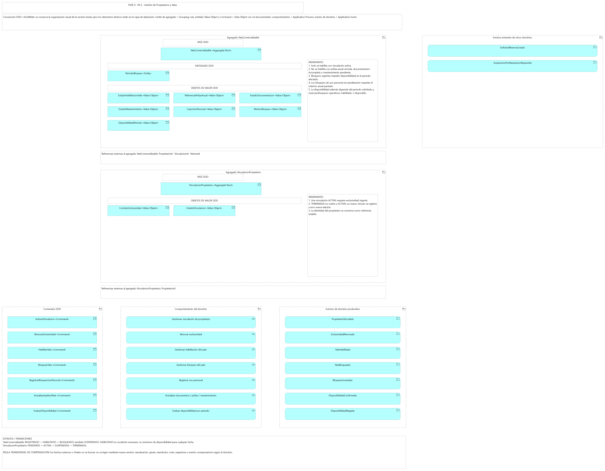

### Análisis

Se separan dos raíces: `VinculacionPropietario` y `YateComercializable`. La primera controla exclusividad y estado del vínculo; la segunda controla habilitación, bloqueos, documentación, póliza anual, mantenimiento, uso personal y disponibilidad por periodo.

### Justificación

La relación contractual con el propietario y el estado comercial del yate tienen ciclos de vida distintos y no deben forzarse en una sola transacción. La vista además corrige una ambigüedad clave: **habilitado no significa disponible**; la disponibilidad depende también de fechas, reservas y bloqueos vigentes.

[Volver al índice](#indice)

---

<a id="v64"></a>
## V6.4 — Gestión de Marinas y Operación Náutica

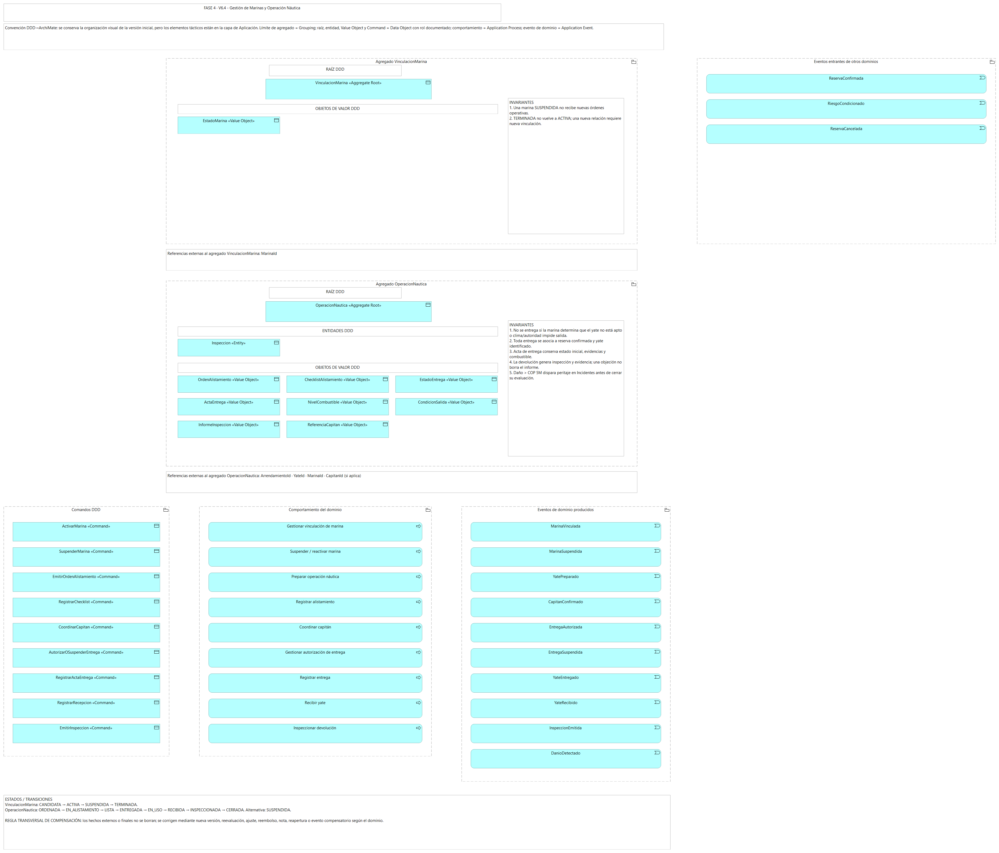

### Análisis

Se distinguen `VinculacionMarina` y `OperacionNautica`. La primera representa la relación estable con una marina; la segunda gobierna una operación concreta: alistamiento, capitán, autorización, entrega, recepción, combustible e inspección.

### Justificación

Una marina puede existir como aliado aunque no haya una operación activa, mientras que cada arriendo crea una operación náutica específica. Separar ambos agregados evita mezclar el ciclo contractual con el ciclo transaccional. La marina usa directamente la plataforma, por lo que no se inventa un sistema externo de marina.

[Volver al índice](#indice)

---

<a id="v65"></a>
## V6.5 — Gestión de Incidentes y Siniestros

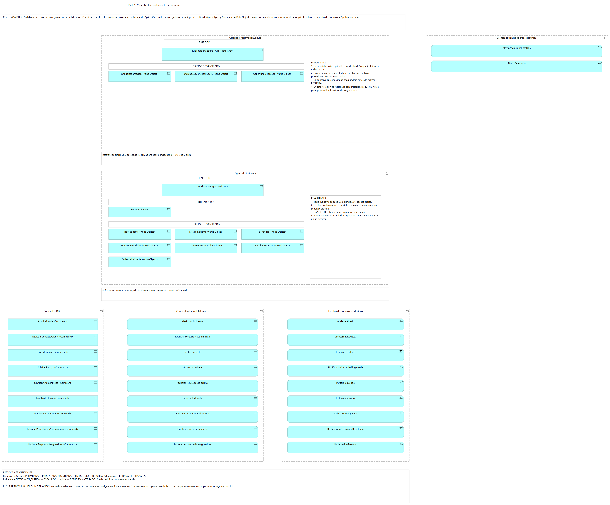

### Análisis

Se modelan dos raíces: `Incidente` y `ReclamacionSeguro`, con `Peritaje` como entidad cuando el daño supera el umbral. El dominio gestiona anomalías, daños, no devolución, escalamiento, evidencia y comunicación con aseguradora/autoridades.

### Justificación

El ciclo operativo de un incidente no es igual al ciclo de una reclamación de seguro. Separarlos permite resolver un incidente aunque la reclamación siga abierta, y evita acoplar el manejo operativo a los tiempos de un tercero. Las notificaciones y respuestas externas quedan auditadas y no se eliminan.

[Volver al índice](#indice)

---

<a id="v66"></a>
## V6.6 — Tarifación y Cotización

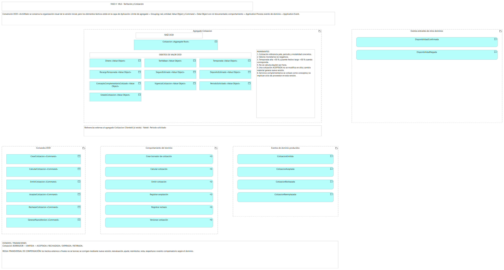

### Análisis

`Cotizacion` es la raíz. Integra tarifa base, temporada, recargos, seguro estimado, depósito estimado, conceptos complementarios, vigencia y periodo solicitado.

### Justificación

El dominio calcula y emite una propuesta económica, pero **no decide riesgo ni ejecuta pagos**. Una cotización aceptada no se modifica silenciosamente; un cambio material genera una nueva versión. Esto protege la consistencia comercial y mantiene separado el precio de la autorización final del arriendo.

[Volver al índice](#indice)

---

<a id="v67"></a>
## V6.7 — Admisibilidad y Cumplimiento

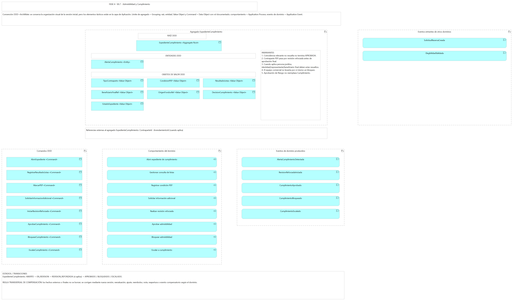

### Análisis

`ExpedienteCumplimiento` registra contraparte, PEP, listas, beneficiario final, origen de fondos, alertas y decisión. Puede aprobar, bloquear o escalar una operación.

### Justificación

Cumplimiento se mantiene independiente de Riesgo porque responde una pregunta distinta. Una operación puede ser aceptable en riesgo y, sin embargo, estar bloqueada por cumplimiento. Una PEP no implica rechazo automático: exige revisión reforzada. Esta separación evita mezclar políticas regulatorias con exposición operativa.

[Volver al índice](#indice)

---

<a id="v68"></a>
## V6.8 — Seguimiento Operacional

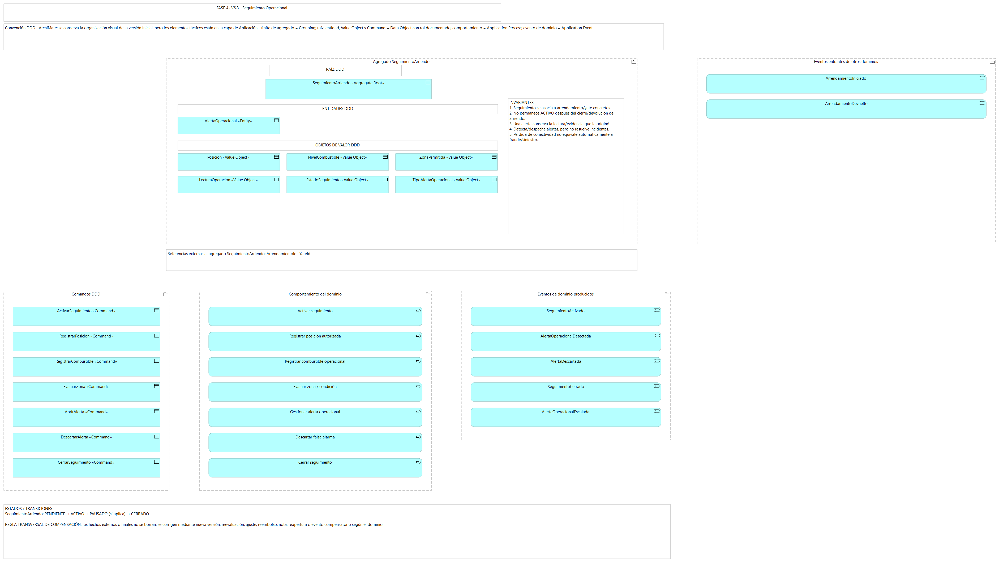

### Análisis

`SeguimientoArriendo` registra posición, combustible, zona permitida y alertas durante la operación. Una `AlertaOperacional` conserva la lectura/evidencia que la originó.

### Justificación

Detectar una alerta no equivale a abrir un incidente. Seguimiento observa, evalúa y escala; Incidentes decide si existe un caso formal. Esta frontera evita que cada desviación o pérdida de conectividad se convierta automáticamente en siniestro o fraude.

[Volver al índice](#indice)

---

<a id="v69"></a>
## V6.9 — Liquidación Económica

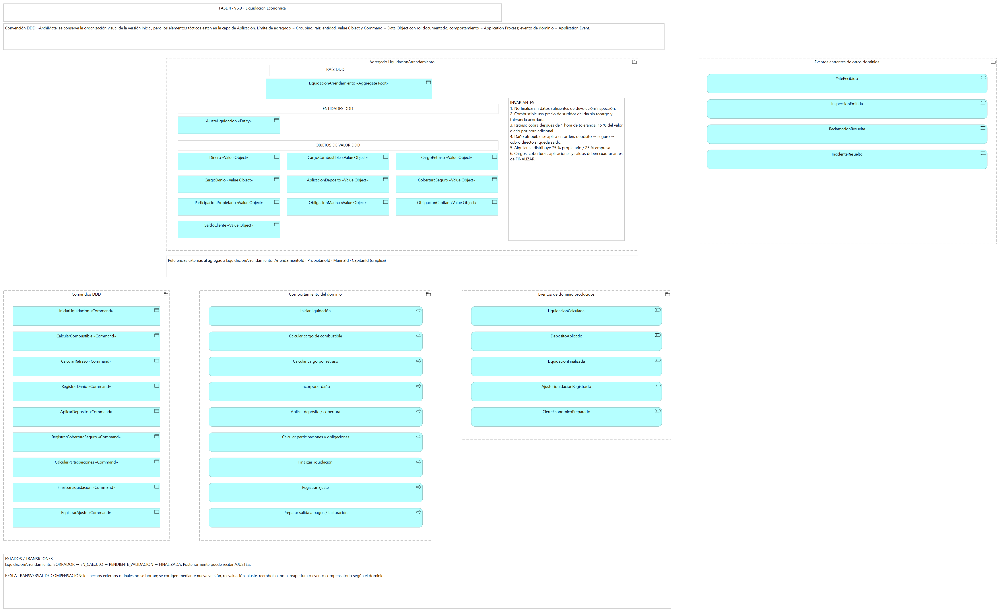

### Análisis

`LiquidacionArrendamiento` calcula combustible, retrasos, daños, aplicación de depósito, cobertura, participación del propietario, obligaciones con marina/capitán y saldo del cliente. Los ajustes posteriores quedan auditados.

### Justificación

Liquidación **decide cuánto corresponde económicamente**, pero no ejecuta movimientos financieros. Por eso permanece separada de Pagos. La regla de reparto 75/25, los cargos de retraso y el orden depósito → seguro → cobro directo se mantienen dentro del cálculo económico antes de emitir una salida hacia Pagos/Facturación.

[Volver al índice](#indice)

---

<a id="v610"></a>
## V6.10 — Reputación y Calidad

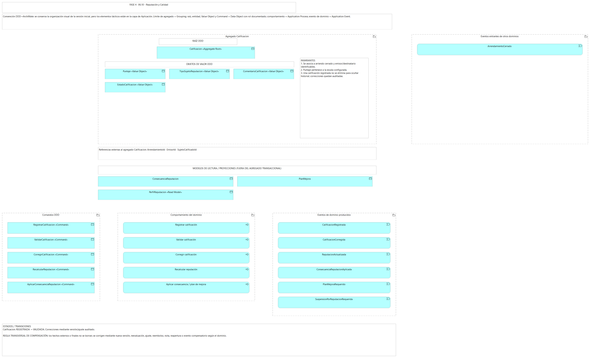

### Análisis

`Calificacion` es el agregado transaccional. Registra emisor, sujeto calificado, puntaje, comentario y estado. A partir de las calificaciones se recalculan reputación, consecuencias y planes de mejora.

### Justificación

El historial reputacional completo no se fuerza dentro de una sola transacción. Las proyecciones de reputación y sus consecuencias se mantienen como resultados derivados. Las calificaciones no se borran para ocultar historial; las correcciones quedan auditadas. El ciclo completo de reclamos permanece fuera del alcance de esta versión.

[Volver al índice](#indice)

---

<a id="v611"></a>
## V6.11 — Pagos y Facturación

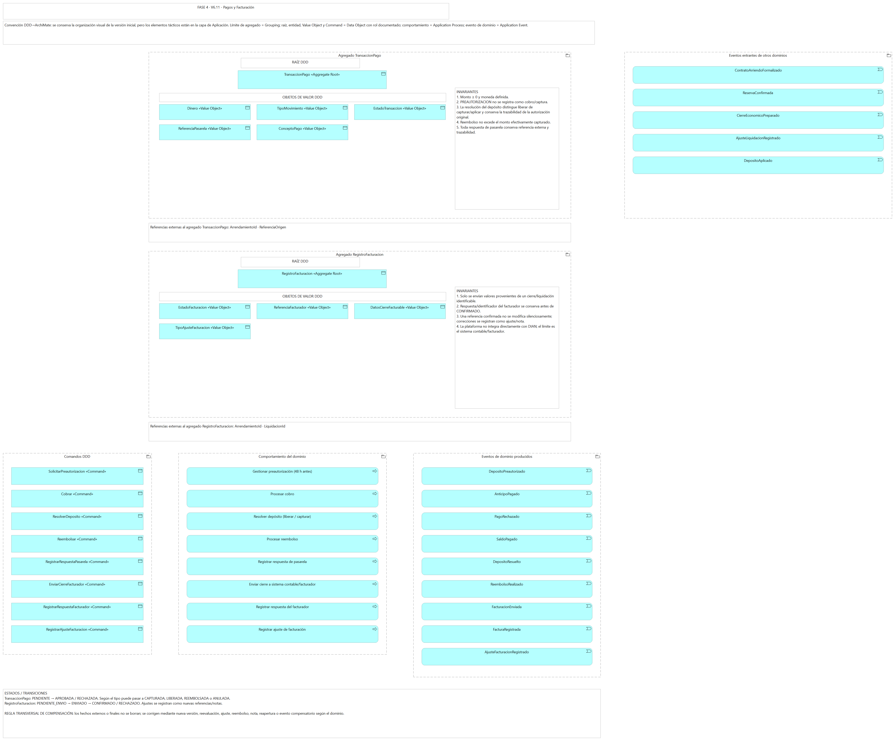

### Análisis

Se usan dos raíces: `TransaccionPago` y `RegistroFacturacion`. La primera gobierna preautorización, cobros, liberaciones, capturas y reembolsos; la segunda registra el envío y respuesta del sistema contable/facturador.

### Justificación

Este dominio es la frontera tecnológica real con A07 y A10. No decide montos de negocio: ejecuta instrucciones provenientes de Arrendamiento/Liquidación y conserva referencias externas. Una preautorización no se trata como cobro, un reembolso no puede exceder lo capturado y una referencia confirmada no se modifica silenciosamente. La plataforma no integra directamente con DIAN; el límite es el sistema contable/facturador.

[Volver al índice](#indice)

---

<a id="v612"></a>
## V6.12 — Analítica y Reportes

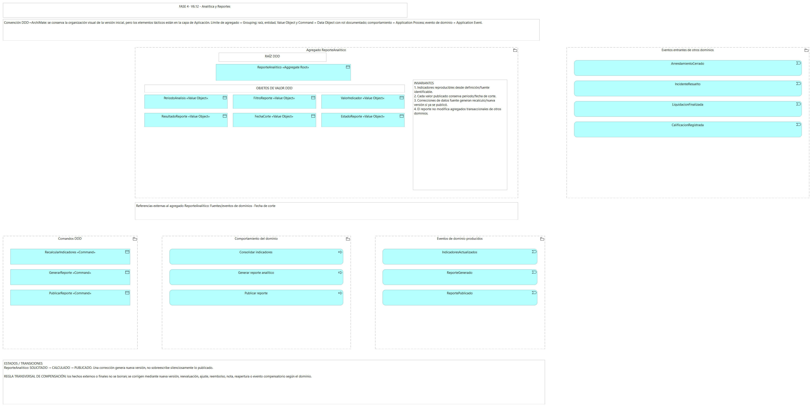

### Análisis

`ReporteAnalitico` consolida indicadores y reportes usando eventos/datos publicados por otros dominios. Conserva periodo, filtros, fecha de corte, valores e información de publicación.

### Justificación

Analítica no modifica agregados transaccionales ni se convierte en fuente de verdad. Los indicadores deben ser reproducibles desde fuentes identificables y una corrección de datos genera recálculo/nueva versión. El agregado de reporte se utiliza para mantener trazabilidad de salidas analíticas concretas.

[Volver al índice](#indice)

---

<a id="fase-5"></a>
# Fase 5 — Mapa de contextos delimitados

La Fase 5 toma los dominios y agregados definitivos y decide los bounded contexts y las relaciones entre ellos. Se mantienen **12 bounded contexts**, pero esto es una decisión del caso y no una regla de equivalencia dominio = contexto.

Los criterios utilizados para conservarlos separados son coherencia del modelo y lenguaje, propiedad de invariantes/datos, ritmo de cambio y responsabilidad operativa. El responsable organizacional puede repetirse entre contextos y no define por sí solo una frontera.

<a id="v8"></a>
## V8 — Mapa de contextos

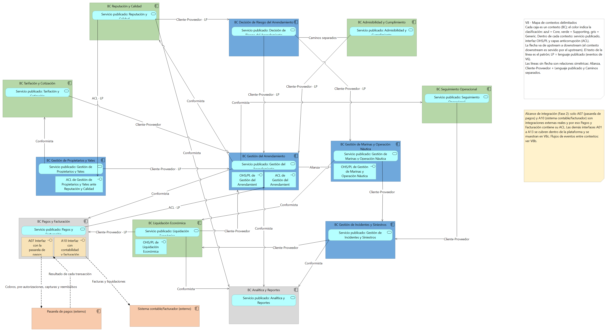

### Análisis

V8 muestra los 12 bounded contexts y sus patrones de relación. Los principales patrones utilizados son:

- **Customer/Supplier:** cuando un contexto downstream necesita un resultado concreto y puede influir en el contrato del upstream.
- **Conformist:** cuando el downstream adopta el lenguaje publicado del upstream sin exigirle cambios.
- **Partnership / Alianza:** entre Gestión del Arrendamiento y Gestión de Marinas y Operación Náutica, por colaboración bidireccional entre dos contextos Core.
- **Separate Ways:** cuando dos contextos deliberadamente no se integran, como Riesgo y Cumplimiento entre sí.
- **Published Language:** eventos con significado estable entre contextos.
- **Open Host Service:** para contratos públicos reutilizados por varios consumidores.
- **Anti-Corruption Layer:** cuando un contexto debe traducir/protegerse del modelo de otro contexto o sistema externo.

En la versión final **no se utiliza Shared Kernel entre Liquidación y Pagos**. Liquidación es upstream y decide los importes; Pagos es downstream y ejecuta/registra, mediante **Customer/Supplier + Published Language**.

### Justificación de modelado

La vista usa `Application Component` para bounded contexts, `Application Service` para servicios publicados e `Application Interface` para OHS/ACL. Los patrones se eligen según dependencia y propiedad del modelo, no para “usar uno de cada tipo”. El objetivo es minimizar acoplamiento y proteger especialmente los contextos que implementan subdominios Core.

[Volver al índice](#indice)

---

<a id="v8b"></a>
## V8b — Flujos de eventos entre contextos

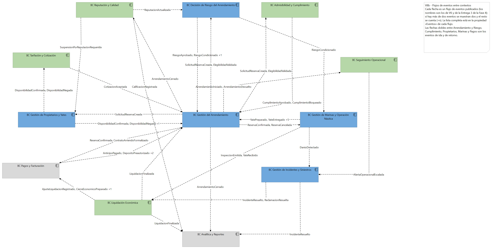

### Análisis

V8b hace explícito el lenguaje publicado entre bounded contexts. Las flechas representan eventos de V6 y permiten ver qué contexto produce y cuál consume cada hecho de negocio. Los flujos más densos se concentran alrededor de Gestión del Arrendamiento porque actúa como orquestador del ciclo, pero no es dueño de las decisiones internas de los demás contextos.

### Justificación de modelado

Separar V8 y V8b mejora legibilidad: V8 explica **el patrón de relación** y V8b explica **qué información realmente circula**. Los eventos publicados evitan compartir entidades internas y mantienen independencia entre modelos.

[Volver al índice](#indice)

---

<a id="v8c"></a>
## V8c — Fronteras externas y tratamiento actual

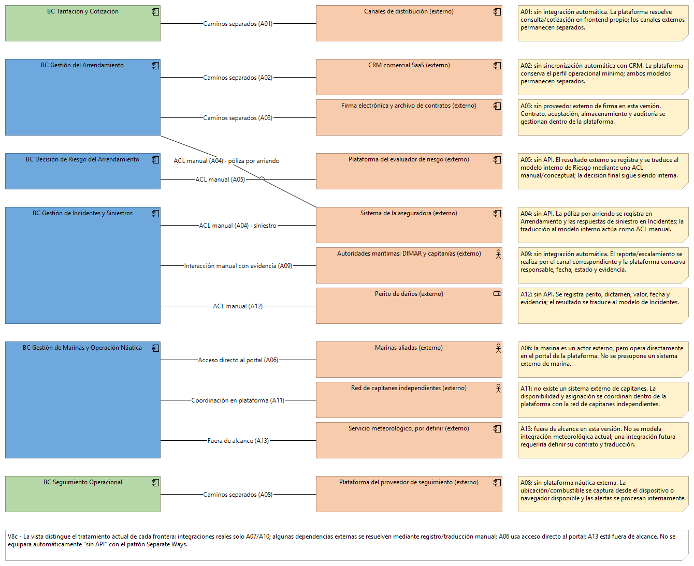

### Análisis

V8c corrige una interpretación importante: **“sin API” no significa automáticamente Separate Ways**. Se distinguen:

- **Separate Ways:** la plataforma cubre deliberadamente la necesidad con modelo propio, como A01/A02/A03 en el alcance actual y A08 respecto de una plataforma náutica especializada.
- **ACL manual/conceptual:** existe información externa que debe traducirse al modelo interno aunque no haya API, como A05 evaluador, A04 aseguradora y A12 perito.
- **Interacción manual con evidencia:** A09 autoridades marítimas.
- **Acceso directo de actor externo:** A06 marina usa el portal.
- **Actor coordinado dentro de la plataforma:** A11 red de capitanes.
- **Fuera de alcance:** A13 meteorología.

A07 y A10 permanecen como integraciones reales y se detallan en V9.

### Justificación de modelado

La vista documenta la frontera actual sin inventar automatizaciones. Permite diferenciar una dependencia semántica de una integración tecnológica. Esto es fundamental para que la arquitectura refleje el alcance real y para que futuras automatizaciones puedan incorporar adaptadores/ACL sin contaminar los modelos internos.

[Volver al índice](#indice)

---

<a id="fase-6"></a>
# Fase 6 — Bounded Context Canvas

<a id="v11"></a>
## V11 — Bounded Context Canvas — Gestión del Arrendamiento

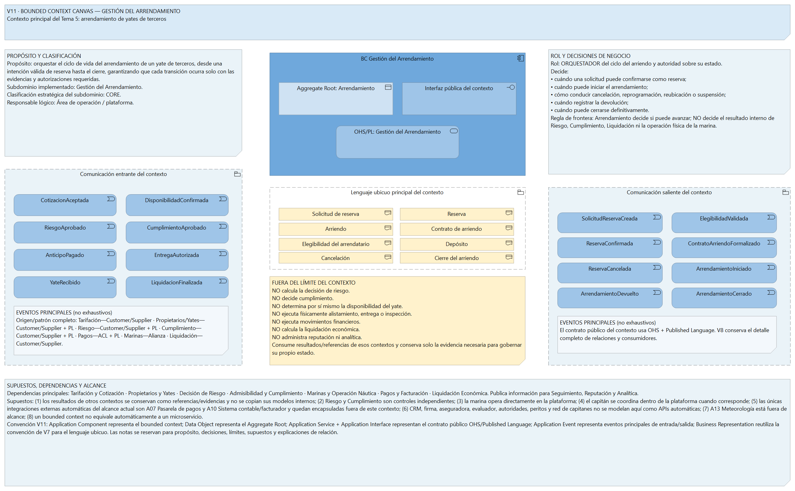

### Análisis

Se selecciona **Gestión del Arrendamiento** como bounded context principal porque contiene el agregado `Arrendamiento`, gobierna su ciclo de vida y concentra la coordinación con Riesgo, Cumplimiento, Propietarios/Yates, Marinas, Pagos y Liquidación.

El Canvas resume en una sola página:

- propósito y clasificación estratégica;
- rol del contexto;
- Aggregate Root principal;
- lenguaje ubicuo principal;
- comunicación entrante;
- comunicación saliente;
- decisiones de negocio;
- elementos fuera del límite;
- dependencias y supuestos.

### Justificación de modelado

V11 combina elementos ArchiMate semánticos con notas de Canvas. `Application Component` representa el bounded context; `Data Object` representa el Aggregate Root; `Application Service` + `Application Interface` representan OHS/Published Language; `Application Event` representa eventos principales de entrada/salida; y `Business Representation` reutiliza la convención de V7 para términos de lenguaje ubicuo. Las notas se reservan para propósito, decisiones, límites y supuestos.

El contexto decide **si su propio ciclo puede avanzar**, pero no calcula Riesgo, no decide Cumplimiento, no ejecuta físicamente la operación de marina, no procesa movimientos financieros y no calcula la liquidación económica. Esa frontera evita convertirlo en un “God Context”.

[Volver al índice](#indice)

---

<a id="v10"></a>
# Vista transversal — V10 Trazabilidad vertical

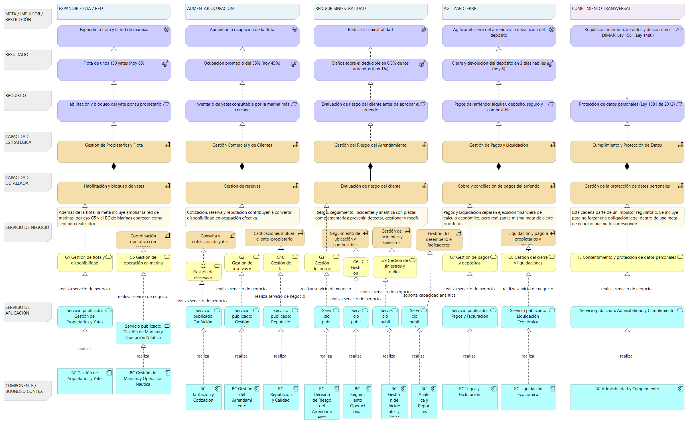

### Análisis

V10 integra las capas del modelo y demuestra que los componentes de aplicación no aparecen de forma aislada. La trazabilidad debe poder seguirse desde **meta/motivación → requisito → capacidad → servicio de negocio → dominio/contexto → componente de aplicación**.

Ejemplos de cadenas que deben quedar visibles:

- **Reducir siniestralidad** → capacidades de Gestión del Riesgo → servicios de decisión/seguimiento → BC Decisión de Riesgo / BC Incidentes.
- **Agilizar cierre y devolución del depósito** → Gestión de Pagos y Liquidación → servicios G7/G8 → BC Liquidación Económica + BC Pagos y Facturación.
- **Expandir flota y red de marinas** → Gestión de Propietarios/Flota + Gestión de Marinas → servicios de vinculación/operación → BC Propietarios y Yates + BC Marinas y Operación Náutica.

### Justificación de modelado

V10 utiliza relaciones de `Realization`, `Influence`, `Serving` y `Assignment` según el tipo de vínculo. Su función es demostrar coherencia vertical entre las capas y cerrar la trazabilidad iniciada en V1, V2, V4d y V4e. No reemplaza las vistas detalladas; las conecta.

[Volver al índice](#indice)

---

<a id="tabla-de-aportes"></a>
## Tabla de aportes

Cada fila indica qué vista construyó cada integrante.

### Resumen por integrante

| Integrante | Fases | Vistas |
|---|---|---|
| **Gloria** | 1, 2 y 5 | V1, V2, V3, V4b, V8, V8b |
| **Juan Sebastián** | 2, 5 | V4, V4c, V4d, V4e, V9, V9b, V8c |
| **Isabella** | 3, 4 y 6 | V5, V7 (Core y Generic), V6.1, V6.3, V6.5, V6.7, V6.9, V6.11, V11 |
| **Thomas** | 3, 4 y transversal | V10, V7 (Supporting y Términos polisémicos), V6.2, V6.4, V6.6, V6.8, V6.10, V6.12 |

### Detalle por vista

| Fase | Vista | Integrante |
|---|---|---|
| 1 | V1 — Motivación | Gloria |
| 1 | V2 — Mapa de capacidades | Gloria |
| 1 | V3 — Cadena de valor y proceso E2E | Gloria |
| 2 | V4 — Descomposición de servicios | Juan Sebastián |
| 2 | V4b — Servicios, roles, funciones y contratos | Gloria |
| 2 | V4c — Servicios fundamentales e infraestructura | Juan Sebastián |
| 2 | V4d — Trazabilidad servicio–capacidad–requisito–meta | Juan Sebastián |
| 2 | V4e — Trazabilidad de servicios a capacidades | Juan Sebastián |
| 2 | V9 — Interoperabilidad y anticorrupción | Juan Sebastián |
| 2 | V9b — Vínculo vertical y contratos de integración | Juan Sebastián |
| 3 | V5 — Dominios y clasificación | Isabella |
| 3 | V7 — Lenguaje ubicuo Core | Isabella |
| 3 | V7 — Lenguaje ubicuo Generic | Isabella |
| 3 | V7 — Lenguaje ubicuo Supporting | Thomas |
| 3 | V7 — Términos polisémicos | Thomas |
| 4 | V6.1 — Gestión del Arrendamiento | Isabella |
| 4 | V6.2 — Decisión de Riesgo | Thomas |
| 4 | V6.3 — Propietarios y Yates | Isabella |
| 4 | V6.4 — Marinas y Operación Náutica | Thomas |
| 4 | V6.5 — Incidentes y Siniestros | Isabella |
| 4 | V6.6 — Tarifación y Cotización | Thomas |
| 4 | V6.7 — Admisibilidad y Cumplimiento | Isabella |
| 4 | V6.8 — Seguimiento Operacional | Thomas |
| 4 | V6.9 — Liquidación Económica | Isabella |
| 4 | V6.10 — Reputación y Calidad | Thomas |
| 4 | V6.11 — Pagos y Facturación | Isabella |
| 4 | V6.12 — Analítica y Reportes | Thomas |
| 5 | V8 — Mapa de contextos | Gloria |
| 5 | V8b — Flujos de eventos entre contextos | Gloria |
| 5 | V8c — Fronteras externas y tratamiento actual | Juan Sebastián |
| 6 | V11 — Canvas de Gestión del Arrendamiento | Isabella |
| Transversal | V10 — Trazabilidad vertical | Thomas |


---

<a id="fuentes-del-proyecto"></a>
# Fuentes del proyecto

1. **Enunciado del trabajo:** `Proyecto_Diseño_Arquitectura_ArchiMate.docx`.
2. **Entrevista de negocio:** `Entrevista de negocio arrendamiento de yates de terceros.docx`.
3. **Preguntas adicionales y aclaraciones:** `Preguntas_adicionales_entrevista_yates.docx`.
4. **Material de clase DDD:** `9_DDD_Diseño.pptx`.
5. **Material SOA y descomposición de servicios** utilizado en Fases 1–2.
6. **ArchiMate 3.1 Specification — The Open Group** como referencia semántica de elementos y relaciones.
7. Modelo fuente final: [`modelo/Modelo_Yates_Final.archimate`](modelo/Modelo_Yates_Final.archimate).

---

